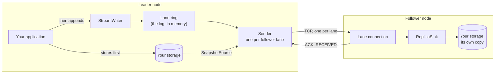
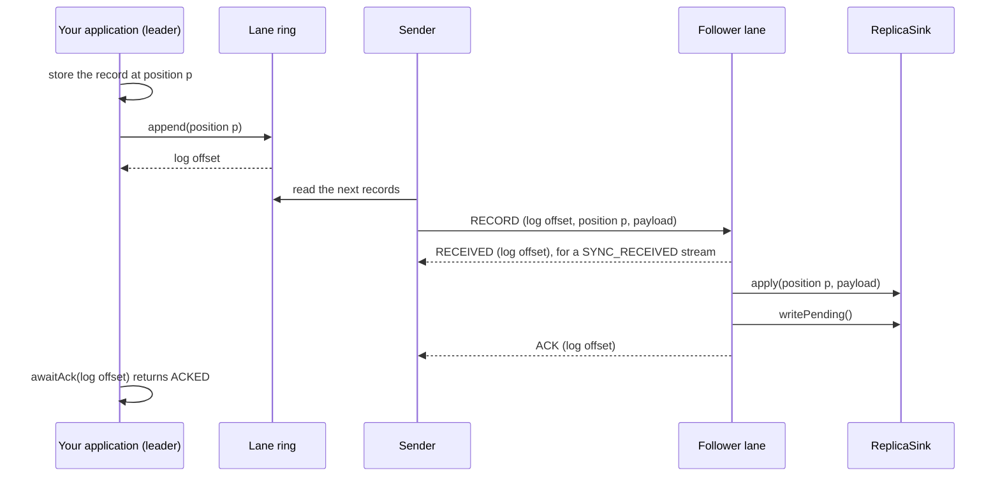
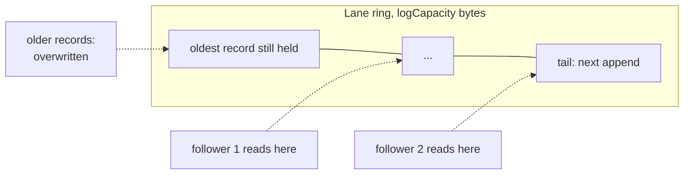
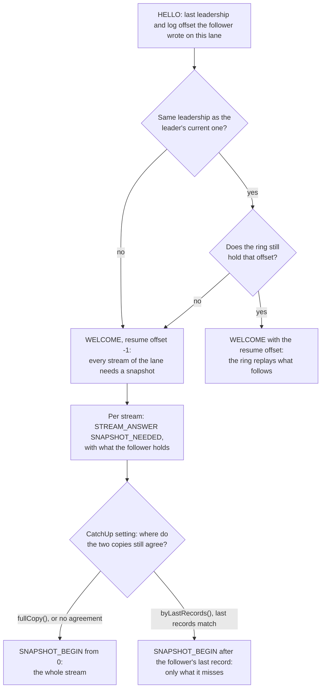
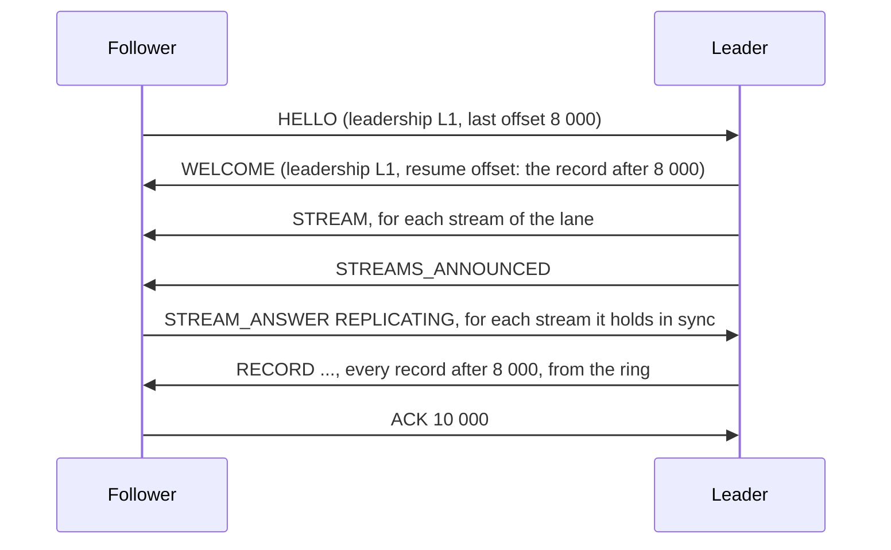
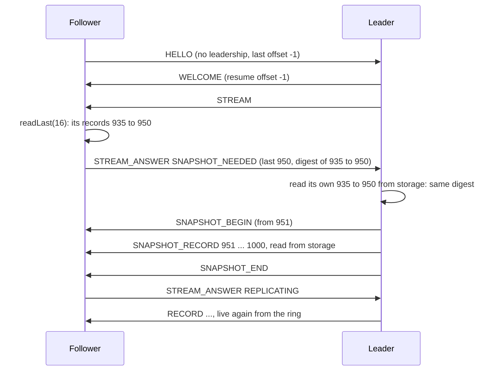
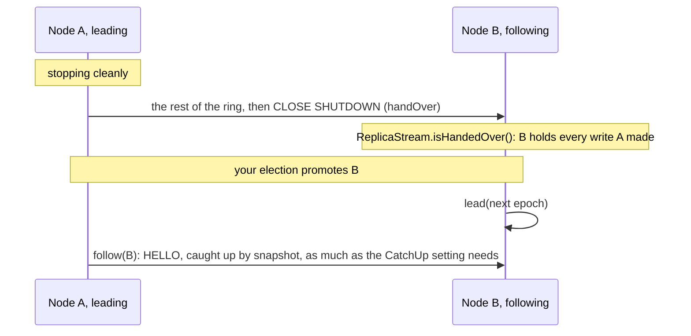

# How replication works

What happens between `StreamWriter.append` on the leader and `ReplicaSink.apply` on a follower, how a follower
catches up after a disconnect, a restart or a failover, and what each choice costs. The wire format itself is in
[protocol.md](protocol.md); this guide explains the behaviour behind it.

## 1. The pieces

- **A stream** is a sequence of records your application writes, each at a **position** that increases between two
  resets: a FIX session's seqnums, a journal's entry numbers. Your application stores the records itself, on the
  leader in its storage and on each follower in that follower's own copy. Replicos carries the bytes and never reads
  them.
- **A lane** is one TCP connection per follower and one **ring** on the leader. Stream `k` goes over lane
  `k % lanes`, so a snapshot or a slow stream only holds back its own lane. One lane by default.
- **The ring** holds the lane's latest records in the order they were appended, each at a **log offset**, the byte
  where it starts in the lane's log. It lives in the leader's memory, `logCapacity` bytes per lane (16 MiB by
  default). See [section 3](#3-the-ring-a-replay-window).
- **Positions are yours, offsets are replicos'.** A position names a record in your stream and means the same on
  every node. A log offset names a place in one leader's ring and means nothing anywhere else: not on another leader,
  not after this leader restarts.
- **An epoch** numbers leaderships. It comes from your election (replicos does not elect), and every frame carries it
  so a follower refuses a deposed leader.
- **A leadership** is a random id a node draws each time `lead()` is called. It tells apart two leaderships at the
  same epoch, such as a leader restarted by an application that reuses its epoch.

What your application implements, in `org.lolaf.replicos.spi`:

| where | interface | what it does |
|---|---|---|
| leader | `LeaderStreams`, `LeaderStream` | the streams to replicate: key, name, mode, where they are stored |
| leader | `SnapshotSource` | reads a stream's records back from your storage, by position, and its state |
| follower | `ReplicaSinks` | opens the sink each stream is applied into, or refuses it |
| follower | `ReplicaSink` | applies one stream's records and snapshots into the follower's copy |

## 2. A record's path

- **Store, then append.** Your application stores the record first: a snapshot reads it back from your storage, never
  from the ring.
- **What a write waits for**, per stream:
  - `ASYNC`: nothing; `append` returns once the record is in the ring.
  - `SYNC_RECEIVED`: `awaitAck` returns once a follower holds the record in memory (RECEIVED).
  - `SYNC_APPLIED`: `awaitAck` returns once a follower applied it and its sink wrote it (ACK after `writePending`).
- `awaitAck` waits only for followers **in sync**, those holding every record of the stream: all of them by default,
  or a **quorum** of them, the first to ack, the others getting the record without being waited for. With none in
  sync it returns `NO_FOLLOWER_IN_SYNC` at once, with fewer than the quorum `NOT_ENOUGH_FOLLOWERS`; past its timeout,
  `TIMED_OUT`, and the followers that had not acked are not waited for again until they caught up. The mode, quorum
  and timeout come as an `AckWait`, checked once when built, so the wait itself checks nothing.
- **Sync followers.** `LeaderSettings.syncFollowers` names the followers a `SYNC` append may wait for, by node id: a
  local standby, say, and not a disaster-recovery copy far away, which then replicates as if `ASYNC`. Only they count
  as in sync, since only a failover to one of them is sure to keep every acknowledged write. Empty, the default,
  every follower is one. A second connection claiming a node id already connected is refused, `DUPLICATE_NODE_ID`,
  unless the first has acked nothing for two heartbeats: that is the follower reconnecting before the leader saw its
  connection go, and the first is closed as `STALLED`.
- A follower moves its **lane position**, the leadership and log offset of the last record it wrote, only after
  `writePending`, so it never claims more than its sinks hold. The lane position is kept in memory: see
  [section 5](#5-what-triggers-a-snapshot).

## 3. The ring, a replay window

- **The ring is written on every append**, whether or not a follower is connected. It always holds the latest
  `logCapacity` bytes of records, which is what lets a briefly disconnected follower resume without a snapshot.
- **A connected follower holds appends back.** The ring never overwrites a record a connected follower has not read.
  When a follower falls a whole ring behind, an append waits for it, at most `logFullTimeout` (1 s by default), then
  drops it with `TOO_SLOW`. A dropped follower is refused for `slowFollowerHoldOff` (1 s, doubled at each drop up to a
  minute), then reconnects and is caught up by snapshot, its place in the ring being gone.
- **The ring is not storage.** It is memory, it starts empty when the leader starts, and its offsets are this
  leader's alone. Your storage is the durable copy, and snapshots read from it.

## 4. Connecting and catching up

Each lane connects on its own. The follower says what it last wrote; the leader resumes it from the ring when it can,
and otherwise catches each stream up by snapshot.

### Resumed from the ring

The follower was briefly disconnected from this same leader. The last record it wrote is at log offset 8 000; the
leader has appended up to offset 10 000 since, and its ring still holds offset 8 000.

No snapshot, nothing read from storage: the ring replays what the follower missed.

### Caught up by snapshot

The follower restarted, so it lost its lane position. Its copy of one stream still holds positions 1 to 950, the
leader's holds 1 to 1000, and both nodes catch up with `CatchUp.byLastRecords()`.

The follower keeps positions 1 to 950 and receives 50 records. With `CatchUp.fullCopy()` the leader sends
`SNAPSHOT_BEGIN` from 0, the follower discards its copy, and all 1000 records are copied.

While a snapshot runs, the stream keeps being written: the leader skips the stream's records from the ring and
copies them from storage in later rounds, then hands the stream back to the ring. The other streams of the lane keep
streaming between the snapshot's chunks.

## 5. What triggers a snapshot

| What happened | Resumed from the ring? | Snapshot of |
|---|---|---|
| A short disconnect from the same leader, its ring still holding the follower's offset | yes | nothing |
| `standDown()`, then `follow()` the same leader again, its ring still holding the offset | yes | nothing |
| The follower process restarted, or `close()` then `follow()` | no: lane positions are in memory | every stream of the lane |
| The follower was dropped as too slow (`TOO_SLOW`) | no: the ring overwrote its offset | every stream of the lane |
| Another leader, after a failover | no: its ring is another one | every stream of the lane |
| The same leader restarted, or `lead()` called again, even at the same epoch | no: a new leadership | every stream of the lane |
| A stream the follower did not hold yet, or refused before and now configured | | that stream |
| A connection resumed in the middle of a record longer than a frame | | that stream |
| `resync(streamKey)` on the leader | | that stream, always whole |

"Snapshot of" says which streams are caught up by snapshot. How much each snapshot copies is the `CatchUp` setting's
choice, [section 6](#6-failover-divergence-and-the-catchup-settings): with `fullCopy()` the whole stream, with
`byLastRecords()` only what the follower misses whenever its last records match the leader's.

What you control: `standDown()` keeps the lane positions, so following the same leader again resumes;
`close()` and a process exit lose them.

## 6. Failover, divergence and the `CatchUp` settings

### Failover and hand over

Your election decides who leads. On the node promoted with `lead()`, your application takes its streams over from
that node's copy; the other nodes, the deposed leader included once it comes back, follow it.

`handOver()` on a clean stop lets the promoted node know it lost no write. Without it, after a crash, the promoted
node holds what it had received, and anything the old leader wrote after that is lost to the new leadership.

Promote a sync follower in sync: it holds every write a `SYNC` append was acknowledged for. Any other node, a
disaster-recovery copy say, may lack some, so promoting one is a decision to accept losing them. To weigh it,
`node.leader().getLanePositions()` gives each lane's last record a node wrote, and `node.followers().getLaneStatuses()`
the offset each follower last acknowledged as applied. Offsets compare only within one leadership, so two followers
of the same leader can be compared lane by lane.

### Divergence

After a crash, the deposed leader may hold records that never reached the new leader, which then writes its own at
those positions:

| positions | 1 to 7 | 8 to 10 | 11 to 13 |
|---|---|---|---|
| deposed leader A | shared | **A's own**, never replicated | |
| new leader B | shared | **B's own** | B's own |

When A comes back as a follower, it must end with B's 8 to 10, not keep its own. Positions alone cannot show it: A
holds position 10 and B holds position 10, with different records. Catching A up from position 11 would leave the two
copies silently different. Each `CatchUp` setting answers "from where do the copies still agree" safely.

### The settings compared

Set one on the node builder, the same on every node: `.catchUp(CatchUp.byLastRecords())`.

| | `CatchUp.fullCopy()`, the default | `CatchUp.byLastRecords()` |
|---|---|---|
| How it decides | it does not: every catch-up copies the whole stream | compares the follower's last 16 records with the leader's at the same positions, byte for byte |
| Extra storage | none | none |
| Your `ReplicaSink` implements | nothing more | `readLast`, reading the copy's last records back from storage, and a `snapshotBegin(fromPosition, ...)` that keeps what is before `fromPosition` |
| A follower restarted, or dropped as too slow | whole stream | only what it misses |
| The deposed leader comes back, everything it wrote replicated | whole stream | only what it misses |
| The deposed leader comes back holding records the new leader never got | whole stream | whole stream: its last records differ |
| A new, empty follower | whole stream | whole stream |
| Blind spot | none | two histories that parted earlier but end with the same 16 records, byte for byte |

- **The blind spot** needs records that repeat exactly: the same change written twice, empty markers. Records that
  carry something unique, a timestamp or an id, never fall in it. For records that do repeat, compare more of them:
  `CatchUp.byLastRecords(64)`; each costs one read on both sides, once per stream caught up.
- **Nodes configured differently** catch up by full copy, never by a guess, and the leader logs it once per
  connection.
- **What `readLast` must read** is what the sink's storage durably holds, so a record lost in a crash is not claimed.

## 7. What your storage must guarantee

- **A record is readable from your storage before you append it.** A snapshot reads the stream from storage while it
  keeps being written; a record appended before it is readable could be skipped.
- **Positions increase between two resets.** A snapshot copies by position range. A record you append flagged
  `RecordFlag.RESET` reaches the sink with that flag: discard the copy, then apply it as the first of the new one.
- **A sink may be handed a record it already holds.** Once a snapshot ends, the ring may bring records the snapshot
  already copied: skip them by position.
- **Each node stores its own copy.** A follower refuses a stream the leader stores where the follower would write it.
- **`writePending` makes the writes durable.** A follower acknowledges, and moves its lane position, only after it.
- **Under `byLastRecords()`**, `readLast` reads from durable storage, and `snapshotBegin(fromPosition, ...)` keeps
  exactly what is before `fromPosition` and discards the rest.
